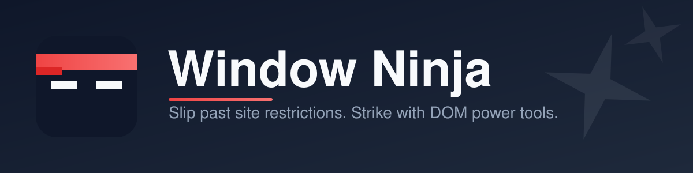

<div align="center">
  
</div>

# Window Ninja

A Chrome extension (Manifest V3) that restores default browsing behaviors on restrictive websites and adds DOM power tools.

Tired of sites that block right-click, kill your clipboard, or trap you behind a modal? Window Ninja slips past the blockers and hands you the tools the site tried to take away. Everything is opt-in per site via the popup, so the extension stays completely dormant on sites you haven't enabled.

## Features

- **Unblockers:** restore right-click, copy/cut/paste, text selection, and dev shortcuts (F12, Ctrl/Cmd+U/S/P, Ctrl/Cmd+Shift+I/J/C)
- **Element eraser:** hover + click to make any element vanish (`Alt+Shift+E`)
- **Input unlocker:** strip `readonly`/`disabled` from form fields (`Alt+Shift+U`)
- **Password reveal:** show password fields as plain text (`Alt+Shift+P`)
- **Overlay remover:** wipe fullscreen modal overlays and scroll locks (`Alt+Shift+O`)

## Install

Load from source:

1. Run `npm install && npm run build`
2. Open `chrome://extensions`, enable Developer mode
3. Click **Load unpacked** and select `dist/chrome-mv3`

## Development

```bash
npm run dev        # dev server, load .output/chrome-mv3 unpacked
npm run compile    # typecheck
npm run build      # production build
npm run zip        # store-ready zip
```

## License

MIT
